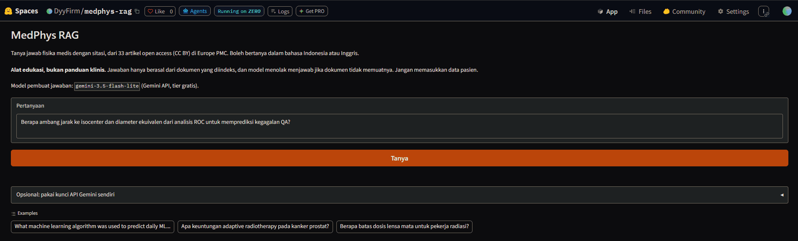

# MedPhys RAG

Question answering over 33 open-access medical physics papers, in English or Indonesian, with citations and a refusal when the documents do not contain the answer. Evaluated on 50 questions I wrote myself.

**[Live demo](https://huggingface.co/spaces/DyyFirm/medphys-rag)** (Hugging Face Space, free tier) · Educational use only. Not clinical guidance.



## What it does

- Retrieves passages with hybrid search (multilingual dense embeddings + BM25).
- Asks an LLM to answer **only** from the retrieved passages, cite them, and say so when the answer is not there.
- Rejects clearly off-topic questions before calling the LLM.

## Results

50 hand-written questions: 40 answerable from the corpus (20 English, 20 Indonesian) and 10 that are not covered (5 English, 5 Indonesian). 95% intervals are Wilson intervals. With these sample sizes, differences of one or two questions are noise.

**Retrieval** (40 answerable questions, document level):

| Method | R@1 | R@5 | MRR |
|---|---|---|---|
| Dense (multilingual-e5-small) | 0.850 | 1.000 | 0.908 |
| BM25 | 0.800 | 0.975 | 0.850 |
| Hybrid (RRF) | 0.875 | 1.000 | 0.921 |

By language, R@1 for dense / BM25 / hybrid: English 0.95 / 0.95 / 0.90, Indonesian 0.75 / 0.65 / 0.85. The generation step sees 8 chunks, so the number that matters is whether the right document is among them: with the final setting (hybrid, at most 3 chunks per document) the gold document was in the top 8 chunks for 40/40 questions (top 5: 39/40).

**Generation** (final configuration, temperature 0):

| Measure | Result | 95% CI |
|---|---|---|
| Answered an answerable question | 40/40 | 0.91 – 1.00 |
| Refused an unanswerable question | 10/10 | 0.72 – 1.00 |
| Cited the correct document | 40/40 | 0.91 – 1.00 |
| Fully correct (manual) | 30/40 = 0.75 | 0.60 – 0.86 |
| Correct or partially correct (manual) | 39/40 = 0.975 | 0.87 – 1.00 |
| Faithful to the cited text (manual, after re-check) | 38/40 = 0.95 | 0.84 – 0.99 |

The first-pass faithfulness score was 0.70 (28/40), because the evidence shown to the grader was cut at 500 characters. I re-checked the 12 failures against the full text; 10 turned out to be supported. The re-check only looked at failures, which is justified because truncation can only create false failures, but one grader (me) judged everything.

**Where it falls short.** Of 10 answers that were not fully correct, 9 were partial and 1 wrong. Partial answers are mostly omissions on questions that ask for several items ("which two methods", "number and percentage"). By question type, fully correct: numeric 18/21, method 7/13, concept 4/4, comparison 1/2. English questions scored lower than Indonesian (12/20 vs 18/20), but 13 of the 20 English questions were of the method type and 19 of the 20 Indonesian ones were numeric, so language and type cannot be separated in this set. The two faithfulness failures were a range that belonged to a different review (misattribution) and a misspelled model name.

## Deployment checks

Smoke test on the live demo, run by me (`tests/demo_smoke_tests.csv`): 18/18 passed. It covers answerable questions in both languages, refusals for uncovered questions, an off-topic question that passes the topic gate and is then refused by the model, input-length handling, and a prompt asking the model to ignore its rules. Ten of these questions come from the evaluation set, so this checks that the deployment behaves like the notebook; it is not an accuracy measure.

Also checked: the usage limit triggers for repeated distinct questions, and an invalid user-supplied API key returns a generic error without exposing details. Not tested: whether the per-visitor limit is isolated across different networks.

## How it works

1. **Corpus:** 33 full-text articles from Europe PMC, filtered to CC BY licences (`data/sources.csv`).
2. **Chunks:** the article XML is split by section into roughly 1,000-character passages (1,277 chunks). Tables and figure captions are not indexed.
3. **Retrieval:** `intfloat/multilingual-e5-small` embeddings + BM25, fused with reciprocal rank fusion, at most 3 chunks per document, top 8 kept.
4. **Topic gate:** questions whose best dense similarity is below 0.78 are rejected without an LLM call.
5. **Answer:** `gemini-3.5-flash-lite` through the free Gemini API returns JSON (answerable, answer, citations); the app shows the cited passages with links. The same model was used for the evaluation below and in the live demo.

## Evaluation notes and caveats

- Questions, reference answers and document labels were written by me. The 10 unanswerable questions were checked with keyword search over the corpus and by reading hits.
- **Tuned on the evaluation set.** After the first full run I changed three things: the number of chunks (5 to 8), a cap of 3 chunks per document, and temperature 0. I also rewrote 4 questions that did not name the document they referred to. Reported numbers are probably optimistic.
- The topic-gate threshold comes from 5 off-topic questions, so treat it as a coarse filter.
- Labels are at document level only, so chunk-level retrieval accuracy is not measured.
- Single grader. The corpus is 33 papers from 2026, so the model is unlikely to have seen them.

## Limitations

- Small corpus and small test set.
- Tables and captions are not indexed, so answers that live only there are missed.
- Multi-item questions often get incomplete answers.
- Free-tier API: the demo limits each visitor to 10 questions per hour and the service to 12 requests per minute and 300 per day on the shared key, caches repeated questions, and lets visitors use their own Gemini key. The model or quota may change at any time.
- The per-visitor limit keys on the client address, which may be shared behind a proxy.
- Single grader and one author wrote the questions; no second annotator.

## What I would do next

Index tables and captions, prompt for complete answers on multi-item questions, label gold chunks (not just documents) to measure chunk-level retrieval, add a second grader, and re-test on questions written after the pipeline was frozen.

## Run it

- **Notebook:** `notebooks/medphys_rag.ipynb` (Colab) builds the corpus, index, answers and evaluation. Put your Gemini key in Colab Secrets as `GEMINI_API_KEY`; never commit keys.
- **App:** `space/` holds the Gradio app deployed to the Hugging Face Space. It needs `GEMINI_API_KEY` as a Space secret, and the model can be changed with the `LLM_MODEL` variable. Free Gradio Spaces run on ZeroGPU, which refuses to start an app without a `@spaces.GPU` function, so `app.py` contains an unused one; the app itself runs on CPU.

## Data and licences

Articles are open access under CC BY via Europe PMC; titles, DOIs and licences are listed in `data/sources.csv`, and passages shown by the app link back to the source article. `data/chunks.jsonl` contains passages from these articles under their original licence. Code: MIT.

## Repository layout

```
assets/      demo.gif
data/        sources.csv, chunks.jsonl, eval_questions.csv
notebooks/   medphys_rag.ipynb
results/     rag_outputs.jsonl, manual_review.csv
space/       app.py, requirements.txt, chunks_filtered.jsonl, embeddings_e5small.npy
tests/       demo_smoke_tests.csv
```